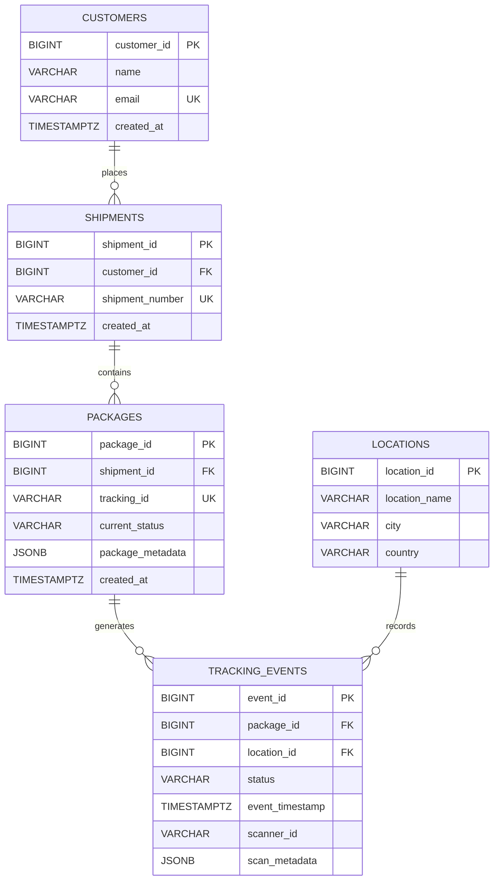

# Logistics Shipment Tracking Backend

A Python backend service developed for the PBEM04 Database Fundamentals lab. This project demonstrates relational database design, transactional data processing, Redis caching, MongoDB event logging, analytical SQL, and database query optimization.

The system tracks shipments and packages as they move between locations. PostgreSQL acts as the primary source of truth, Redis stores the latest package status for fast access, and MongoDB stores additional scanner-event information.

## 1. Project Objectives

The project demonstrates how to:

- Design a normalized relational database with appropriate primary and foreign keys.
- Maintain data integrity using constraints and transactions.
- Process package tracking scans using Python and `psycopg2`.
- Use connection pooling for PostgreSQL database connections.
- Integrate PostgreSQL with Redis and MongoDB.
- Store flexible metadata using PostgreSQL JSONB.
- Write analytical SQL queries using CTEs and window functions.
- Analyze query performance using `EXPLAIN ANALYZE`.
- Improve query performance using a composite index.
- Validate functionality through automated tests and integration scripts.

## 2. Features

- Normalized PostgreSQL database containing customers, shipments, packages, locations, and tracking events.
- Atomic package-status updates and tracking-event insertion within a PostgreSQL transaction.
- Parameterized SQL queries to reduce SQL injection risks.
- PostgreSQL connection pooling.
- Redis caching of the latest package status.
- MongoDB storage for scanner-event documents.
- JSONB columns for flexible package and scanner metadata.
- Tracking-history analytics using CTEs, `LAG()`, and `ROW_NUMBER()`.
- Query performance benchmarking with `EXPLAIN ANALYZE`.
- Composite indexing for optimized tracking-history queries.
- Automated tests, Ruff linting, and Black formatting.

## 3. Technology Stack

| Technology | Purpose |
|---|---|
| Python | Backend application logic |
| PostgreSQL 16 | Primary relational database |
| Redis 7 | Latest package-status cache |
| MongoDB 7 | Scanner-event document storage |
| psycopg2 | PostgreSQL connectivity |
| redis-py | Redis integration |
| PyMongo | MongoDB integration |
| Docker Compose | Local database infrastructure |
| pytest | Automated testing |
| pytest-cov | Test coverage |
| Ruff | Python linting |
| Black | Python code formatting |

## 4. Database Design

The database uses five core relational tables.

| Table | Purpose |
|---|---|
| `customers` | Stores customer information |
| `shipments` | Stores shipments associated with customers |
| `packages` | Stores packages, tracking identifiers, current statuses, and metadata |
| `locations` | Stores locations where package scans occur |
| `tracking_events` | Stores the historical tracking events for packages |

### 4.1 Entity Relationship Diagram

The following diagram illustrates the relationships between the five core tables.



### 4.2 Table Relationships

- **Customers → Shipments:** One customer can have multiple shipments. Each shipment belongs to a customer.
- **Shipments → Packages:** One shipment can contain multiple packages. Each package belongs to a shipment.
- **Packages → Tracking Events:** One package can have multiple tracking events throughout its journey.
- **Locations → Tracking Events:** One location can be associated with multiple tracking events.

### 4.3 Data Integrity and Database Design

The schema uses:

- **Primary keys:** Uniquely identify records in each table.
- **Foreign keys:** Connect related records and maintain referential integrity.
- **Unique constraints:** Prevent duplicate customer emails, shipment numbers, and tracking IDs.
- **NOT NULL constraints:** Ensure required fields contain values.
- **CHECK constraints:** Restrict package and event statuses to supported values.
- **JSONB:** Stores flexible package and scanner metadata without requiring additional relational columns for every possible attribute.
- **Timestamps:** Record when packages and tracking events are created.

The design separates customers, shipments, packages, locations, and tracking events into related tables to reduce unnecessary duplication and improve data consistency.

## 5. Project Structure

```text
logistics-shipment-tracking-backend/
│
├── app/
│   ├── __init__.py
│   ├── database.py
│   ├── external_stores.py
│   └── services/
│       ├── __init__.py
│       ├── tracking_service.py
│       └── tracking_integration.py
│
├── docs/
│   └── performance-report.md
│
├── scripts/
│   ├── benchmark_tracking_queries.py
│   ├── verify_end_to_end_scan.py
│   └── verify_external_stores.py
│
├── sql/
│   ├── schema.sql
│   ├── seed.sql
│   ├── analytics.sql
│   └── indexes.sql
│
├── tests/
│   ├── test_database.py
│   ├── test_tracking_integration.py
│   └── test_tracking_service.py
│
├── .env.example
├── .gitignore
├── docker-compose.yml
├── requirements.txt
└── README.md
```

## 6. Prerequisites

Install the following tools:

- Git
- Python 3.11 or later
- Docker Desktop
- Docker Compose
- Visual Studio Code (recommended)

## 7. Installation and Setup

### 7.1 Clone the Repository

```powershell
git clone https://github.com/Aline-CROIRE/logistics-shipment-tracking-backend.git
cd logistics-shipment-tracking-backend
```

### 7.2 Create and Activate a Virtual Environment

```powershell
python -m venv .venv
.\.venv\Scripts\Activate.ps1
```

### 7.3 Install Dependencies

```powershell
python -m pip install --upgrade pip
pip install -r requirements.txt
```

### 7.4 Configure Environment Variables

Create a local environment file:

```powershell
Copy-Item .env.example .env
```

Update `.env` with your local database credentials.

Example configuration:

```env
POSTGRES_DB=logistics
POSTGRES_USER=logistics_user
POSTGRES_PASSWORD=your_local_password
POSTGRES_HOST=localhost
POSTGRES_PORT=5432

REDIS_HOST=localhost
REDIS_PORT=6379

MONGODB_URI=mongodb://localhost:27017/
MONGODB_DATABASE=logistics
```

Do not commit `.env` or share its credentials. The `.env.example` file provides the configuration template.

### 7.5 Start the Database Services

Start PostgreSQL, Redis, and MongoDB:

```powershell
docker compose up -d --wait
```

Check their status:

```powershell
docker compose ps
```

All three services should be running and healthy.

### 7.6 Create the Database Schema

Apply the SQL schema:

```powershell
Get-Content sql/schema.sql | docker compose exec -T postgres psql -U logistics_user -d logistics
```

### 7.7 Load Sample Data

```powershell
Get-Content sql/seed.sql | docker compose exec -T postgres psql -U logistics_user -d logistics
```

The seed script provides sample customers, shipments, packages, locations, and tracking events.

The seed data includes tracking identifiers such as `TRK-1001`, `TRK-1002`, `TRK-1003`, and `TRK-1004`.

## 8. Tracking Scan Processing

The main business operation is implemented in:

`app/services/tracking_service.py`

The `process_tracking_scan()` function processes a package scan.

Its responsibilities include:

1. Validate the package ID, location ID, status, scanner ID, and metadata.
2. Retrieve and update the package's current status.
3. Insert a new tracking event.
4. Commit both database changes in one transaction.
5. Roll back the transaction if an error occurs.

The package-status update and tracking-event insertion are handled together so that the PostgreSQL database does not retain only one of the two changes when an operation fails.

SQL statements use parameters rather than string concatenation.

### 8.1 Transaction Management

`app/database.py` manages PostgreSQL connections using `psycopg2.pool.SimpleConnectionPool`.

The connection manager:

- Reuses database connections.
- Commits successful operations.
- Rolls back failed operations.
- Returns connections to the pool.

### 8.2 Redis Integration

After a successful PostgreSQL scan, the integration service updates Redis using this key structure:

```text
package:<tracking_id>:status
```

Example:

```text
package:TRK-1001:status
```

The cached JSON value follows this structure:

```json
{
  "status": "In Transit",
  "location": "Kigali Distribution Centre"
}
```

Redis provides a fast way to retrieve the latest package status without repeatedly querying the relational database.

### 8.3 MongoDB Integration

MongoDB stores additional scanner-event information in the `scanner_events` collection.

A scanner-event document contains information such as:

- Package tracking identifier.
- Scanner identifier.
- Event timestamp.
- Location context.
- Additional scanner metadata.

PostgreSQL remains the primary source of truth.

**Transaction boundary:** PostgreSQL changes are committed before Redis and MongoDB are updated. The external-store operations are not part of the same distributed ACID transaction. If an external-store operation fails, the integration service records the failure rather than claiming that the PostgreSQL transaction was rolled back.

## 9. Analytics and SQL Queries

Analytical queries are located in:

`sql/analytics.sql`

The project demonstrates three important SQL techniques.

### 9.1 Common Table Expressions (CTEs)

CTEs organize complex queries into readable logical steps.

The tracking-history query combines package information, tracking events, and locations to reconstruct a package's movement history.

### 9.2 LAG() Window Function

`LAG()` retrieves the previous tracking event for the same package.

This makes it possible to calculate the time between consecutive tracking events.

### 9.3 ROW_NUMBER() Window Function

`ROW_NUMBER()` ranks tracking events for each package by timestamp.

It can be used to identify the latest tracking event for every package.

To execute the analytics queries:

```powershell
Get-Content sql/analytics.sql | docker compose exec -T postgres psql -U logistics_user -d logistics
```

Alternatively, open `sql/analytics.sql` in a PostgreSQL client and execute the individual queries.

## 10. Query Optimization and Indexing

The project evaluates tracking-history query performance using `EXPLAIN ANALYZE`.

The benchmark script:

`scripts/benchmark_tracking_queries.py`

It creates a synthetic workload of:

- 1,000 packages.
- 200,000 tracking events.

It measures query performance before and after creating a composite index.

### 10.1 Composite Index

The index is defined in `sql/indexes.sql`:

```sql
CREATE INDEX idx_tracking_events_package_timestamp
ON tracking_events (package_id, event_timestamp);
```

The index supports queries that filter tracking events by package and order them by timestamp.

### 10.2 Benchmark Results

The recorded benchmark results were:

| Metric | Before Index | After Index |
|---|---:|---:|
| Planning time | 0.168 ms | 0.229 ms |
| Execution time | 20.116 ms | 0.421 ms |
| Returned rows | 200 | 200 |
| Query plan | Sequential scan | Index scan |

<escape>**Recorded execution-time reduction: 97.91%.**</escape>

The query plan changed from a sequential scan and sorting operation to an index-based scan with incremental sorting.

These results are from the project's synthetic workload and a particular local database run. They should not be interpreted as a guaranteed performance improvement for every production workload.

For the full benchmark methodology, query-plan observations, and limitations, see:

[`docs/performance-report.md`](docs/performance-report.md)

**Important:** The benchmark script refuses to run if the benchmark index already exists. The benchmark has already been executed, and the index is retained in the database. Do not rerun it on the current database without first reviewing the script's cleanup and setup requirements.

## 11. Testing and Code Quality

The project uses `pytest` for automated tests.

Run the test suite:

```powershell
pytest -v
```

Run tests with coverage:

```powershell
pytest --cov=app --cov-report=term-missing
```

Run Ruff:

```powershell
ruff check .
```

Check Black formatting:

```powershell
black --check .
```

Format files with Black when necessary:

```powershell
black .
```

### 11.1 External Store Verification

Verify Redis and MongoDB connectivity:

```powershell
python scripts/verify_external_stores.py
```

The script performs temporary write/read checks against the external stores.

### 11.2 End-to-End Tracking Verification

Run:

```powershell
python scripts/verify_end_to_end_scan.py
```

This script performs a real tracking scan using the seeded database records and verifies the integration flow across PostgreSQL, Redis, and MongoDB. It also cleans up its verification data.

## 12. Application Limitations

This project is a backend service and database integration demonstration, not a complete production logistics platform.

Current limitations include:

- No public HTTP REST API or frontend application.
- No authentication or role-based authorization.
- No production deployment configuration.
- No distributed transaction spanning PostgreSQL, Redis, and MongoDB.
- No background retry or message-queue mechanism for failed external-store updates.
- No real-time GPS tracking hardware integration.
- No production-scale load testing.

These limitations identify possible future improvements.

## 13. Future Improvements

Potential improvements include:

- Expose tracking operations through a REST API using FastAPI or Flask.
- Add authentication and authorization.
- Introduce a background worker and message queue for reliable external-store synchronization.
- Add retry policies and structured application logging.
- Add API integration tests.
- Build a shipment-tracking frontend.
- Add deployment and monitoring configuration.
- Evaluate indexing strategies against larger and more varied workloads.

## 14. Conclusion

The Logistics Shipment Tracking Backend demonstrates how relational databases, Python transactions, Redis, MongoDB, analytical SQL, and query optimization can work together in a backend application.

PostgreSQL maintains consistent shipment and tracking records, Redis provides quick access to current package status, and MongoDB stores additional scanner information. Analytical queries provide visibility into package movement, while benchmarking demonstrates the effect of a composite index on a tracking-history query.

The project brings together database design, backend development, integration, testing, and performance analysis in one practical application.