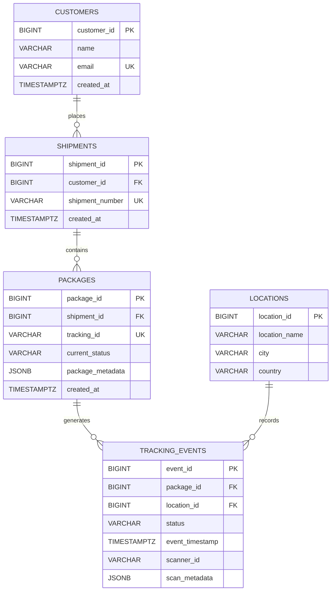

# Logistics Shipment Tracking Backend

A Python data service for a shipment tracking company, built for the PBEM04 Database Fundamentals lab. It processes package scans from warehouses and drivers, records them transactionally in PostgreSQL, caches each package's latest status in Redis, and logs scanner events in MongoDB.

## 1. Overview

| Store | Role |
|---|---|
| PostgreSQL 16 | Source of truth: customers, shipments, packages, locations and tracking events |
| Redis 7 | Fast access to each package's latest status |
| MongoDB 7 | Scanner event documents for auditing |

Python 3.11+ connects to PostgreSQL with `psycopg2` (connection pool), to Redis with `redis-py`, and to MongoDB with `PyMongo`. Docker Compose runs all three databases locally.

## 2. Database Design

| Table | Stores |
|---|---|
| `customers` | Customer name and unique email |
| `shipments` | Shipments placed by a customer |
| `packages` | Packages in a shipment, with tracking ID, current status and JSONB metadata |
| `locations` | Warehouses and hubs where scans happen |
| `tracking_events` | Every scan: package, location, status, time, scanner and JSONB metadata |

### 2.1 Entity Relationship Diagram



A customer has many shipments, a shipment has many packages, and each package has many tracking events. Each event happens at one location.

### 2.2 Normalization

The schema is in third normal form (3NF):

- Every table has a single-column surrogate primary key, and every other column describes only that row's entity.
- Customer details are stored once in `customers` and referenced by `shipments`, rather than repeated on every shipment or package.
- Location details are stored once in `locations`. Each event references a location by `location_id` instead of repeating its name, city and country.
- The scan history is kept in `tracking_events`, one row per scan, rather than in repeated columns on `packages`.

`packages.current_status` is a deliberate exception: it can be derived from the package's latest event. It is stored because "what is this package's status now?" is the most frequent question and the assignment requires it. The copy cannot drift because every scan updates the status and inserts the event in the same transaction.

### 2.3 Integrity Rules

- **Keys:** `BIGINT` identity primary keys. Foreign keys use `ON DELETE RESTRICT`, so history cannot be orphaned.
- **Unique:** customer email, shipment number, tracking ID, and the location (name, city, country).
- **NOT NULL** on all required columns.
- **CHECK:** statuses must be one of `Created`, `In Transit`, `Out for Delivery`, `Delivered`, `Delayed`, `Returned`. JSONB columns must contain a JSON object.
- **JSONB** holds flexible attributes, such as `{"weight_kg": 2.5, "fragile": true}` on a package.
- **Timestamps** use `TIMESTAMPTZ`, so times from different regions compare correctly.

## 3. Project Structure

```text
app/
  database.py                  PostgreSQL connection pool and transaction context
  external_stores.py           Redis and MongoDB clients
  services/
    tracking_service.py        process_tracking_scan(): the PostgreSQL transaction
    tracking_integration.py    Publishes scans to Redis/MongoDB; reads cached status
sql/
  schema.sql                   Tables and constraints
  seed.sql                     Sample data (TRK-1001 to TRK-1004)
  indexes.sql                  Composite index for tracking history
  analytics.sql                CTE and window-function queries
scripts/
  benchmark_tracking_queries.py   EXPLAIN ANALYZE benchmark, before and after the index
  verify_external_stores.py       Live Redis and MongoDB check
  verify_end_to_end_scan.py       Live scan across all three stores
tests/                         pytest suite
docs/performance-report.md     Benchmark method, results and query plans
demo.py                        Interactive demonstration menu
docker-compose.yml             PostgreSQL, Redis and MongoDB services
```

## 4. Setup

Prerequisites: Git, Python 3.11 or later, and Docker Desktop. The commands below are for PowerShell.

**1. Clone and create a virtual environment**

```powershell
git clone https://github.com/Aline-CROIRE/logistics-shipment-tracking-backend.git
cd logistics-shipment-tracking-backend
python -m venv .venv
.\.venv\Scripts\Activate.ps1
pip install -r requirements.txt
```

If PowerShell blocks the activation script, run `Set-ExecutionPolicy -Scope Process -ExecutionPolicy Bypass` first. Activate the environment in every new terminal before running the project.

**2. Configure environment variables**

```powershell
Copy-Item .env.example .env
```

Set `POSTGRES_PASSWORD` in `.env`. The other values in `.env.example` match `docker-compose.yml`. Never commit `.env`.

| Variable | Default | Purpose |
|---|---|---|
| `POSTGRES_HOST`, `POSTGRES_PORT` | `localhost`, `5432` | PostgreSQL address |
| `POSTGRES_DB`, `POSTGRES_USER` | `logistics`, `logistics_user` | Database and user |
| `POSTGRES_PASSWORD` | none | Required. Docker Compose also uses it to create the user. |
| `REDIS_HOST`, `REDIS_PORT` | `localhost`, `6379` | Redis address |
| `MONGODB_URI`, `MONGODB_DATABASE` | `mongodb://localhost:27017/`, `logistics` | MongoDB address and database |

**3. Start the databases**

```powershell
docker compose up -d --wait
```

All three services should show as healthy in `docker compose ps`.

**4. Create the schema, load sample data and add the index**

```powershell
Get-Content sql/schema.sql  | docker compose exec -T postgres psql -U logistics_user -d logistics
Get-Content sql/seed.sql    | docker compose exec -T postgres psql -U logistics_user -d logistics
Get-Content sql/indexes.sql | docker compose exec -T postgres psql -U logistics_user -d logistics
```

`schema.sql` runs once on an empty database. `seed.sql` and `indexes.sql` are safe to run again.

## 5. Interactive Demo

```powershell
python demo.py
```

| Option | Shows |
|---|---|
| 1, 2 | All packages, or one package with its shipment and customer |
| 3 | Process a scan through PostgreSQL, Redis and MongoDB |
| 4 | Full tracking history from PostgreSQL |
| 5 | Latest status through the Redis cache (reports a cache hit or miss) |
| 6 | Scanner event documents stored in MongoDB |
| 7 | Minutes between consecutive scans (CTE + `LAG()`) |

A suggested walkthrough: run option 3 for `TRK-1001`, then options 4, 5 and 6 to see the same scan in each store. Scanning a delivered package shows the scan being rejected.

## 6. Tracking Scan Processing

### 6.1 The PostgreSQL Transaction

`process_tracking_scan(package_id, location_id, status, scanner_id=None, scan_metadata=None)` in `app/services/tracking_service.py`:

1. Validates the inputs and checks that the status is supported.
2. Locks the package row with `SELECT ... FOR UPDATE`, so concurrent scans of one package run one at a time.
3. Rejects the scan if the package is already `Delivered` or `Returned`, because its journey is complete.
4. Updates `packages.current_status`.
5. Inserts the event into `tracking_events`.

All of this runs in one transaction. The connection context in `app/database.py` commits only if every step succeeds and rolls back otherwise, so a status is never changed without its event, or the other way round. Every query uses `%s` parameters, never string formatting.

### 6.2 Redis Cache

`process_and_publish_tracking_scan()` in `app/services/tracking_integration.py` runs the transaction above, then updates Redis and MongoDB.

Each package's latest status is cached under `package:<tracking_id>:status`:

```json
{"status": "In Transit", "location": "Kigali, Rwanda"}
```

`get_package_status(tracking_id)` reads this cache:

- **Cache hit:** the value is returned from Redis.
- **Cache miss:** the status is read from PostgreSQL, using the location of the latest event, and written back to Redis.
- **Redis unavailable:** PostgreSQL still answers.

Cached values expire after one hour. If a cache update ever fails, the old value cannot stay wrong for long, and the next read refreshes it.

### 6.3 MongoDB Scanner Log

Each processed scan is stored in the `scanner_events` collection, for example:

```json
{
  "event_id": 42, "package_id": 1, "tracking_id": "TRK-1001",
  "location_id": 1, "location_name": "Kigali Distribution Centre",
  "city": "Kigali", "country": "Rwanda",
  "status": "In Transit", "scanner_id": "SCANNER-KGL-01",
  "event_timestamp": "2026-10-30T06:08:57Z",
  "scan_metadata": {"source": "dispatch"}
}
```

### 6.4 Consistency Between Stores

PostgreSQL commits first. Redis and MongoDB are updated afterwards, outside the PostgreSQL transaction. If either fails, the scan stays committed, the error is logged and returned in `integration_errors`, and the other store is still attempted. PostgreSQL is always the source of truth: Redis expires and refills from it.

## 7. Analytics Queries

`sql/analytics.sql` contains three queries:

| Query | Technique | Answers |
|---|---|---|
| 1. Tracking history | CTE | Every scan for one package (`TRK-1001`), with locations, in time order |
| 2. Time between scans | CTE + `LAG()` | Minutes since each package's previous scan |
| 3. Latest event | `ROW_NUMBER()` | Each package's most recent scan, including packages not yet scanned |

Events are ordered by `event_timestamp`, then `event_id`, so two scans with the same timestamp always come out in a fixed order.

```powershell
Get-Content sql/analytics.sql | docker compose exec -T postgres psql -U logistics_user -d logistics
```

## 8. Query Optimization

Tracking history is read by filtering `tracking_events` on one package and ordering by time. The composite index in `sql/indexes.sql` supports exactly that access pattern:

```sql
CREATE INDEX idx_tracking_events_package_timestamp
ON tracking_events (package_id, event_timestamp);
```

`scripts/benchmark_tracking_queries.py` loads 1,000 packages and 200,000 tracking events, then measures both queries with `EXPLAIN (ANALYZE, BUFFERS)` before and after creating the index. Each figure is the median of five runs; ranges cover three separate benchmark runs.

| Query | Before index | After index | Improvement |
|---|---:|---:|---:|
| Event lookup by `package_id` | 10.2 – 12.0 ms | 0.09 – 0.11 ms | ≈ 99% |
| Tracking history (CTE + `LAG()`) | 15.2 – 18.5 ms | 0.41 – 0.47 ms | ≈ 97% |

Without the index, PostgreSQL scans every row in `tracking_events` (about 7,360 pages) to find one package's 200 events. With the index, it reads only those entries (75–80 pages), already ordered by time.

The full method, query plans, and limitations are in the [performance report](docs/performance-report.md).

```powershell
python scripts/benchmark_tracking_queries.py
```

The benchmark can be run repeatedly. It works inside one transaction, removes its synthetic data afterwards, and leaves the index in place. Timings vary by machine; the change in query plan is the reliable result.

## 9. Testing and Verification

The tests need the Docker services running with the schema and seed data loaded.

```powershell
pytest -v
pytest --cov=app --cov-report=term-missing
ruff check .
black --check .
```

| Test file | Covers |
|---|---|
| `test_tracking_service.py` | Successful scan; invalid status; unknown package; rollback when the event insert fails; rejected scans after `Delivered`/`Returned` |
| `test_analytics.py` | The `analytics.sql` queries against known data: history order, `LAG()` intervals per package, latest event with timestamp ties |
| `test_tracking_integration.py` | Redis and MongoDB updates; each store failing independently; cache hit, miss and Redis-down fallback |
| `test_database.py` | Connection and required tables |

Database tests create their own data and remove it afterwards. Two scripts check the real services:

```powershell
python scripts/verify_external_stores.py   # Redis and MongoDB read/write
python scripts/verify_end_to_end_scan.py   # one real scan across all three stores, then cleanup
```

## 10. Limitations

- This is a backend data service only. There is no HTTP API, user interface or authentication.
- Redis and MongoDB updates happen after the PostgreSQL commit and are not retried automatically. A failed cache update is corrected by expiry; a failed MongoDB write is logged but not replayed.
- The event timestamp is the time the database records the scan. A scan uploaded late is recorded at upload time.
- Benchmark figures come from synthetic data on a single development machine.
